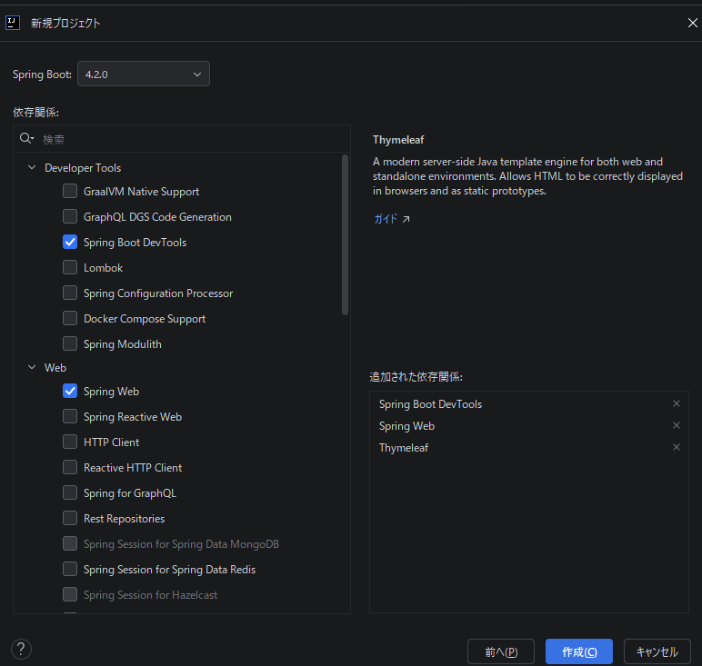
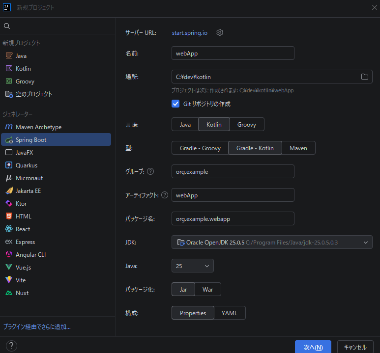

# Kotlin_WEBアプリ作成方法

## 1.プロジェクト新規作成

**File → New → Project → Spring Boot**（またはSpring Initializr）

| 項目 | 設定値 |
|---|---|
| Language | **Kotlin** |
| Type | **Gradle - Kotlin**（推奨） |
| JDK | 21など |
| Group / Artifact | 例：`com.example` / `demo` |
| Packaging | Jar |



> 依存関係

- **Spring Web**：REST APIやWebサーバーに必要（必須）
- **Thymeleaf**：HTML画面を作る場合
- **Spring Boot DevTools**：変更時の自動再起動
- 必要に応じて、DBを使うなら **Spring Data JPA** と **H2 Database** も追加します



## 2. REST APIを作成

`src/main/kotlin/com/example/demo/` に `HelloController.kt` を作成します。

```kotlin
package com.example.demo

import org.springframework.web.bind.annotation.GetMapping
import org.springframework.web.bind.annotation.RequestMapping
import org.springframework.web.bind.annotation.RequestParam
import org.springframework.web.bind.annotation.RestController

data class Greeting(val id: Long, val message: String)

@RestController
@RequestMapping("/api")
class HelloController {

    @GetMapping("/hello")
    fun hello(@RequestParam(defaultValue = "World") name: String): Greeting {
        val trimmed = name.trim()
        val message = "Hello, $trimmed!"
        return Greeting(1, message)
    }
}
```

>  実行

`DemoApplication.kt` の `main` 関数の横にある ▶ ボタンをクリック（ターミナルなら `.\gradlew.bat bootRun`）。

起動したら、ブラウザで次のURLにアクセス
```
http://localhost:8080/api/hello?name=Taro
```
→ `{"id":1,"message":"Hello, Taro!"}` と表示されればOK

## 3. HTML画面を作成（Thymeleafの場合）

**コントローラー**（`PageController.kt`）：
```kotlin
package com.example.demo

import org.springframework.stereotype.Controller
import org.springframework.ui.Model
import org.springframework.web.bind.annotation.GetMapping
import org.springframework.web.bind.annotation.RequestParam

@Controller
class PageController {
    @GetMapping("/")
    fun index(
        @RequestParam(defaultValue = "Kotlin-Webアプリ") title: String,
        model: Model
    ): String{
        model.addAttribute("title", title)
        return "index"
    }
}
```

**テンプレート**（`src/main/resources/templates/index.html`）：
```html
<!DOCTYPE html>
<html xmlns:th="http://www.thymeleaf.org">
<head><meta charset="UTF-8"><title>Demo</title></head>
<body>
  <h1 th:text="${title}">タイトル</h1>
</body>
</html>
```

`http://localhost:8080/` を開くと、ページが表示されます。

## 4.tailwindCssを導入

| 方法 | Node.js | 用途 |
|---|---|---|
| 1 npm | 必要 | フロント開発に慣れている場合 |
| 2 スタンドアロンCLI | 不要 | CLIコマンドで実行可能 |

### 4-1. 入力用CSSを作成
`src/main/tailwind/input.css`：
```css
@import "tailwindcss";

/* Thymeleafテンプレート内のクラスをスキャン対象にする */
@source "../resources/templates";
```

### 4-2.npmを使う場合

Node.jsがインストール済みなら、次のように設定します。

```powershell
npm init -y
npm install tailwindcss @tailwindcss/cli
```

`package.json` に以下を追加します。
```json
"scripts": {
  "watch": "tailwindcss -i src/main/tailwind/input.css -o src/main/resources/static/css/output.css --watch",
  "build": "tailwindcss -i src/main/tailwind/input.css -o src/main/resources/static/css/output.css --minify"
}
```

- `npm run watch` で監視、`npm run build` で本番用のCSSを生成
- `node_modules` は `.gitignore` に追加

### 4-3. テンプレートから読み込む
```html
<!DOCTYPE html>
<html xmlns:th="http://www.thymeleaf.org">
<head>
  <meta charset="UTF-8">
  <title>Demo</title>
  <link rel="stylesheet" th:href="@{/css/output.css}">
</head>
<body class="bg-gray-100 min-h-screen flex items-center justify-center">
  <div class="bg-white rounded-xl shadow-lg p-8">
    <h1 class="text-3xl font-bold text-blue-600" th:text="${title}">タイトル</h1>
    <button class="mt-4 px-4 py-2 bg-blue-500 text-white rounded hover:bg-blue-600">
      ボタン
    </button>
  </div>
</body>
</html>
```

### 4-4.スタンドアロンCLIを使用する場合

- [Tailwind CSSのGitHubリリースページ](https://github.com/tailwindlabs/tailwindcss/releases/latest) から `tailwindcss-windows-x64.exe` をダウンロード
- プロジェクト直下に `tailwindcss.exe` という名前でおく

> ビルド（監視モード）
IntelliJのターミナル（PowerShell）で、次のコマンドを実行します。
```powershell
.\tailwindcss.exe -i src/main/tailwind/input.css -o src/main/resources/static/css/output.css --watch
```

- 本番用には、`--watch` を外して `--minify` を付ける

> Gradleビルドに組み込む

- `build.gradle.kts` に追加

```kotlin
val tailwindBuild by tasks.registering(Exec::class) {
    commandLine("./tailwindcss.exe",
        "-i", "src/main/tailwind/input.css",
        "-o", "src/main/resources/static/css/output.css",
        "--minify")
}

tasks.named("processResources") {
    dependsOn(tailwindBuild)
}
```

### 4-5.開発時の注意点
- **ブラウザへの反映**：DevToolsを入れていても、静的ファイルの変更が反映されないことがあります。その場合は `application.properties` に `spring.thymeleaf.cache=false` を追加し、IntelliJで「Build → Build Project」（Ctrl+F9）を実行してください。
- **補完**：IntelliJには標準でTailwind CSSのサポート（クラス名の補完・色のプレビュー）があります。効かない場合は、Settings → Plugins で「Tailwind CSS」が有効か確認してください。
- **Git管理**：`output.css` は生成物なので、`.gitignore` に入れてビルド時に生成する運用がおすすめです。