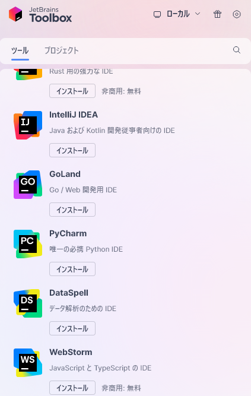
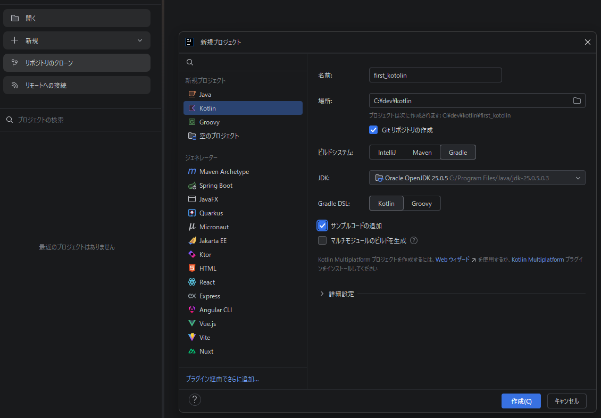

# Kotolin開発環境構築手順

## 1. 概要

| 項目 | 内容 |
|------|------|
| OS | Windows 11（64bit） |
| IDE | IntelliJ IDEA（無料で使える統合版） |
| JDK | JDK 25 |
| ビルドツール | Gradle9.1以上 |
| 言語 | Kotlin（IntelliJ IDEA に同梱） |
| 任意 | Kotlin コマンドラインコンパイラ、Git |

## 2.JDKインストール

> ダウンロード

https://www.oracle.com/jp/java/technologies/downloads/#jdk25-windows

- ダウンロードが完了したら、該当のexeファイルを実行

> 環境変数の設定

- システム環境変数で新しい変数を作成

```txt
JAVA_HOME
C:\Program Files\Java\jdk-25.0.5.0.3
```

- システム環境変数に下記のパスを設定

```sh
%JAVA_HOME%\bin
```

> 確認

``` powerShell
java -version
javac -version
echo $env:JAVA_HOME
```

## 3. IntelliJ IDEA のインストール

https://www.jetbrains.com/ja-jp/help/idea/installation-guide.html
https://www.jetbrains.com/ja-jp/idea/download/?section=windows

> JetBrains Toolbox Appをインストール

https://www.jetbrains.com/ja-jp/toolbox-app/




## 4. IntelliJ IDEA の初期設定

- IntelliJ IDEA を起動し、利用規約に同意
- Kotlin プラグインの確認
  - File > Settings > Plugins でKotlinを検索、有効になっている事を確認

> エンコーディング設定

- File → Settings（Macは IntelliJ IDEA → Settings）→ Editor → File Encodings
- 以下の設定をUTF-8に設定

```txt
Global Encoding
Project Encoding
Default encoding for properties files
```

- Help → Edit Custom VM Options...を開き、下記を追加後に再起動

```txt
-Dfile.encoding=UTF-8
-Dconsole.encoding=UTF-8
```

## 5．Kotlin プロジェクトの作成



| 設定項目 | 推奨値 |
|----------|--------|
| Name | `HelloKotlin` |
| Location | `C:\dev\kotlin` など（日本語・空白を含まないパス） |
| Build system | **Gradle** |
| JDK | C:\Program Files\Java\jdk-25.0.5.0.3 |
| Gradle DSL | **Kotlin** |
| Add sample code | ✅ チェック |

- Create をクリック

- ビルド　＞　同期

> Gradleバージョン確認

- Alt + F12 でターミナルを開く

```powershell
.\gradlew.bat --version
```

> Gradleエンコーディング設定

- build.gradle.kts に下記を追加
```kts
tasks.withType<JavaExec> {
    jvmArgs("-Dfile.encoding=UTF-8", "-Dstdout.encoding=UTF-8", "-Dstderr.encoding=UTF-8")
}
```

- gradle.propertiesに下記を追加
```properties
org.gradle.jvmargs=-Dfile.encoding=UTF-8
```

src/main/kotlin/Main.kt を開き、内容を以下のようにします。

```java
fun main() {
    val name = "Kotlin"
    //TIP ハイライトされたテキストにキャレットがある状態で <shortcut actionId="ShowIntentionActions"/> を押すと
    // IntelliJ IDEA によるその修正案を確認できます。
    println("Hello, " + name + "!")

    for (i in 1..5) {
        //TIP <shortcut actionId="Debug"/> を押してコードのデバッグを開始します。<icon src="AllIcons.Debugger.Db_set_breakpoint"/> ブレークポイントを 1 つ設定しましたが、
        // <shortcut actionId="ToggleLineBreakpoint"/> を押すといつでも他のブレークポイントを追加できます。
        println("i = $i")
    }
}
```

- `fun main()` の左にある **▶（緑の三角）** をクリック → **Run 'MainKt'**
- またはショートカット **Shift + F10**

画面下部の Run ウィンドウに以下が出力されれば成功です。

```
Hello, Kotlin!
i = 1
i = 2
i = 3
i = 4
i = 5
```

> ビルド

- Gradle（象のアイコン）を開く
- プロジェクト名 → Tasks → build → build をダブルクリック
- Runウィンドウに BUILD SUCCESSFUL と出れば完了


## 6.便利なショートカット

| 操作 | ショートカット |
|------|----------------|
| どこでも検索 | **Shift** 2回 |
| アクション検索 | Ctrl + Shift + A |
| 実行 | Shift + F10 |
| デバッグ | Shift + F9 |
| コード補完 | Ctrl + Space |
| クイックフィックス | Alt + Enter |
| コード整形 | Ctrl + Alt + L |
| リネーム | Shift + F6 |
| 定義へ移動 | Ctrl + B |
| ターミナル | Alt + F12 |
| Java → Kotlin 変換 | Ctrl + Alt + Shift + K |

## トラブルシューティング

| 症状 | 原因・対処 |
|------|-----------|
| `java` が認識されない | PATH 未設定。ターミナル／PC を再起動 |
| Gradle 同期が失敗する | ネットワーク／プロキシを確認。`Settings > Build, Execution, Deployment > Build Tools > Gradle` で **Gradle JVM** が正しい JDK か確認 |
| `Unsupported class file major version` | Gradle と JDK のバージョン不整合。Gradle JVM を LTS 版 JDK に変更、または `gradle/wrapper/gradle-wrapper.properties` の Gradle バージョンを更新 |
| 日本語が文字化けする | `Settings > Editor > File Encodings` を **UTF-8** に統一。コンソールは `Help > Edit Custom VM Options` に `-Dfile.encoding=UTF-8` を追加 |
| 社内プロキシ環境で接続できない | `Settings > Appearance & Behavior > System Settings > HTTP Proxy` を設定。Gradle は `%USERPROFILE%\.gradle\gradle.properties` に `systemProp.https.proxyHost` 等を記述 |
| 動作が重い | `Help > Change Memory Settings` でヒープを増やす（例: 2048〜4096MB）。Windows Defender の除外設定に IDE・プロジェクトフォルダを追加（IDE が通知で提案することもあります） |
