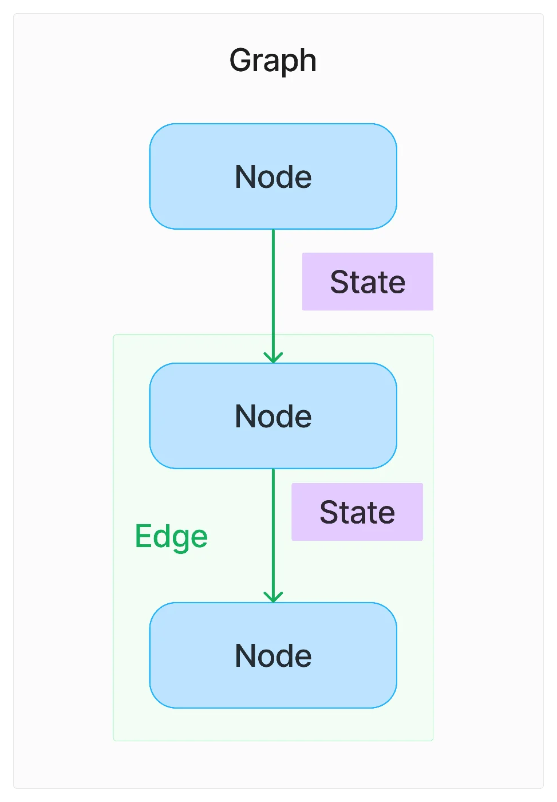
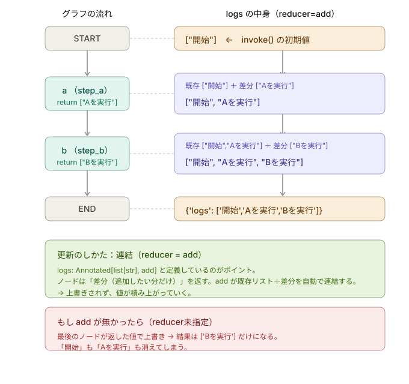

# LangGraphとは

## 1. LangGraphとは

- LangGraphは、ワークフローをグラフ構造としてモデル化し、複雑なタスクの自動化、システムの状態管理を支援します。
- LangChainは一方向の処理フローを定義し、LangGraphは循環的な処理フローを定義します。
- グラフ構造を用いることで、「繰り返し処理」や「分岐処理」を実現ができます。

> LangChainとLangGraphの役割

| | 役割 |
|---|---|
| **LangChain** | LLM の呼び出し、プロンプト、ツール定義、埋め込みなど「部品」を提供 |
| **LangGraph** | それらの部品を「どうつなぎ、分岐・ループ・状態管理するか」を担う「オーケストレーション」 |

## 2. LangGraphの基本概念



|コンポーネント|説明|
|:----|:----|
|Graph|LangGraphの中核となる構成要素で、各NodeとEdgeの集合体です。|
|State|ノード間の遷移の際に保持される情報で、各ノードが参照および更新します。|
|Node|グラフ内の個々のステップや状態を表す要素で、特定のアクションやチェックポイントとして機能します。|
|Edge|ノード間の接続を表し、遷移の条件やアクションを定義します。条件付きエッジなど、特定のロジックに基づいて遷移を制御できます。|

## 3. 基本的な記述方法

> 処理の流れ

```txt
START → ノードA → ノードB → END
```

> 1.State を定義

- LangGraphにおける`State`は、グラフ全体で共有されるデータの入れ物を定義
- `TypedDict`を使い型定義を行う

```py
class State(TypedDict):
    message: str
```

> 2.ノード（関数）を定義

- LangGraphにおける`ノード`は、グラフの中で実際に処理をおこなう`作業単位`
- `State`を受け取って、何らかの処理をして、更新結果を返す

```py
def say_hello(state: State) -> dict:
    return {"message": state["message"] + " こんにちは"}
def say_world(state: State) -> dict:
    return {"message": state["message"] + " 世界"}
```

> 3.グラフを組み立てる

- `部品（ノード）`を繋ぎ合わせて、`実行の流れ（グラフ）`を組み立て
- 基本的に下記の流れで組み立てる
  - ①設計図の土台を用意
  - ②ノードを登録する
  - ③繋がり（エッジ）を定義
  - ④組み立てを完成

```py
def build_graph():
    builder = StateGraph(State) # ①設計図の土台を用意
    builder.add_node("hello", say_hello) # ②ノードを登録する
    builder.add_node("world", say_world)
    builder.add_edge(START, "hello")   # ③繋がり（エッジ）を定義
    builder.add_edge("hello", "world") 
    builder.add_edge("world", END) 
    graph = builder.compile() # ④ 組み立てを完成
    return graph
```

> 4.実行

- ここまで組み立ててきたグラフを、実際に動かす部分

```py
## 組み立てたGraphを呼び出す
lg_compile = build_graph()
result = lg_compile.invoke({"message": request})
```

- 実行の流れ

```sh
invoke({"message": "おはよう"})
   ↓ START → hello
{"message": "おはよう こんにちは"}
   ↓ hello → world
{"message": "おはよう こんにちは 世界"}
   ↓ world → END
result = {"message": "おはよう こんにちは 世界"}
```

> ソース

[02_LG_base.py](./src/02_LG_base.py)

## 4. Reducerについて

「3.基本的な使用方法」では`message` は「最後に返した値で上書き」されました

上書きせずに追記する（リスト型で格納する）場合は**Reducer（リデューサー）** を使います。

**Reducer**は「新しい値を既存の値にどう合成するか」を決める関数です。`Annotated` で型に添えて指定します。



下記の様に**Reducer**を入れて定義します。

```py
from langgraph.graph.message import add_messages
from langchain_core.messages import AnyMessage

class State(TypedDict):
    messages: Annotated[list[AnyMessage], add_messages]
```

## 5. Conditional Edges(条件付きエッジ)について

- 条件付きエッジは「状況を見て行き先を変える」分岐
- 道路の分かれ道に立っていて切替ポイントがあるイメージ

```sh
                       ┌──→ ノードA
Start ── 判断ポイント ──┤
                       └──→ ノードB
```

> 定義方法

```py
from typing import Literal

# State に入力を保持
class State(TypedDict):
    message: str

# ノード（あいさつの本体）
def say_hello_ja(state: State) -> dict: # ノードA
    return {"message": state["message"] + " こんにちは"}
def say_hello_en(state: State) -> dict: # ノードB
    return {"message": state["message"] + " Hello"}

# ① ルーティング関数（振り分け役）
def route(state: State) -> Literal["japanese", "english"]:
    if "英語" in state["message"]:
        return "english"   # 次に進むノード名を返す
    else:
        return "japanese"
```

> グラフ組み立て

```py
def build_graph():
    builder = StateGraph(State)
    # ① ノードを登録
    builder.add_node("japanese", say_hello_ja)
    builder.add_node("english", say_hello_en)
    # ② 条件付きエッジを登録
    builder.add_conditional_edges(START, route)
    # ③ 分岐後はそれぞれ END へ
    builder.add_edge("japanese", END)
    builder.add_edge("english", END)
    return builder.compile()
```